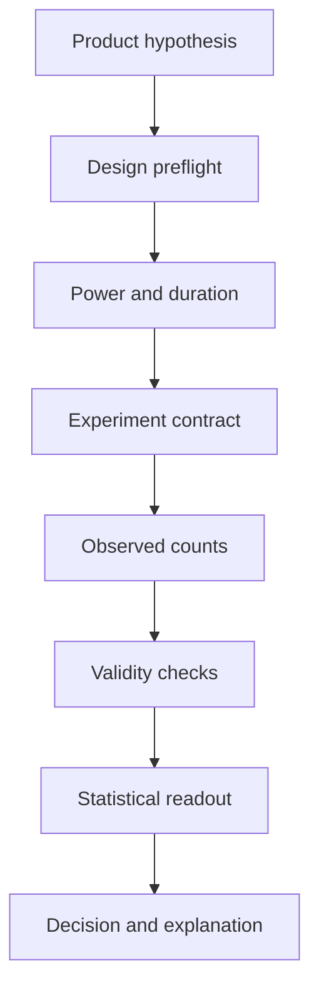

# AI Experimentation Copilot

An evidence-first workspace that helps Product Managers design, validate, and interpret A/B tests—without asking an LLM to do statistics.

The Copilot turns a product hypothesis into a launch-ready experiment contract, calculates the required sample and duration, analyzes observed results, catches validity failures, and produces a transparent **ship / continue / iterate / reject / investigate** recommendation. All calculations are deterministic Python; the explanation layer only narrates facts already present in the result.

> **Status:** working portfolio MVP for two-arm, fixed-horizon experiments with binary outcomes. It runs locally without a paid API, database, or cloud account.

## A useful first evaluation

Design a two-arm binary-outcome experiment, record its sample and duration requirements, then analyze an included example. Inspect validity checks and guardrails before reading the final recommendation.

The current statistics apply to the fixed-horizon design described below. Do not apply the same thresholds to repeated peeking, clustered assignment, multi-arm experiments or continuous metrics without extending and validating the method.

Start with [API orchestration](backend/app/main.py), [example inputs](examples/) and [schema](schema/) when integrating another frontend. Retain the experiment contract and observed counts together so a recommendation can be reproduced.

## Why this is more than an A/B calculator

Most calculators start at conversions and visitors. This project starts before launch and protects the decision after launch.

- **Design preflight:** explicit hypothesis, control, treatment, primary metric, secondary metrics, guardrails, minimum detectable effect, and randomization unit
- **Planning:** power-based sample size, traffic-aware minimum duration, bias checklist, and stopping contract
- **Validity before outcomes:** sample-ratio mismatch, maturity, and unplanned-peeking checks take precedence over a positive p-value
- **Risk-aware readout:** predeclared guardrail thresholds can block shipping
- **Responsible exploration:** segment comparisons use Bonferroni correction; novelty is surfaced as a warning heuristic
- **Auditable decision:** every recommendation is a deterministic policy result with a plain-language reason
- **Honest AI boundary:** no model calculates a p-value or silently changes a decision

## Lifecycle



## Example

**Input**

```text
Hypothesis: Social proof on pricing will increase paid conversion.
Baseline: 8%       Expected relative lift: 5%
Alpha: 5%          Power: 80%
```

The design service returns the required sample, minimum runtime, stopping criteria, risks, and launch readiness. After the test, a readout such as 8.1% vs 8.8% is evaluated alongside assignment balance, elapsed duration, support-ticket guardrails, decision looks, and segments. The supplied example resolves to `ship`; changing it to an imbalanced allocation resolves to `investigate`, even when treatment conversion is higher.

## Quick start

### Docker

```bash
cp .env.example .env
docker compose up --build
```

Open `http://localhost:8000`.

### Local Python

```bash
python -m venv .venv
source .venv/bin/activate
pip install -r requirements.txt
uvicorn backend.app.main:app --reload
```

The interface supports light and dark system themes. API documentation is available at `http://localhost:8000/docs`.

## API

### `POST /api/design`

```bash
curl -X POST http://localhost:8000/api/design \
  -H 'Content-Type: application/json' \
  --data-binary @examples/social-proof-design.json
```

### `POST /api/analyze`

```bash
curl -X POST http://localhost:8000/api/analyze \
  -H 'Content-Type: application/json' \
  --data-binary @examples/social-proof-result.json
```

If `API_TOKEN` is set, add `Authorization: Bearer <token>`. Authentication is deliberately optional only for local development. The JSON contracts are documented in [`schema/`](schema/).

## Deterministic decision policy

The policy is evaluated top to bottom:

| Priority | Condition | Decision |
|---:|---|---|
| 1 | Sample-ratio mismatch | `investigate` |
| 2 | More decision looks than planned | `investigate` |
| 3 | Required sample or minimum duration incomplete | `continue` |
| 4 | Guardrail threshold breached | `reject` |
| 5 | Significant beneficial primary result | `ship` |
| 6 | Significant harmful primary result | `reject` |
| 7 | Completed but inconclusive | `iterate` |

The MVP intentionally supports one fixed-horizon look. Entering a repeated-look plan blocks launch rather than applying an ordinary fixed-horizon p-value to a sequential decision.

## Statistical implementation

- two-sided pooled z-test for independent proportions
- normal-approximation sample size for an equal-sized, two-arm binary test
- chi-square sample-ratio-mismatch check (one degree of freedom)
- Bonferroni adjustment across reported segment comparisons
- early-versus-late effect heuristic for potential novelty decay

See [`docs/STATISTICAL_METHODS.md`](docs/STATISTICAL_METHODS.md) for assumptions, precedence, and limitations.

## Verify the project

```bash
python -m compileall -q backend scripts tests
node --check frontend/app.js
python -m unittest discover -s tests -v
python scripts/evaluate.py
```

The repository currently contains **23 unit tests** and **6 decision-policy acceptance cases**. CI runs compilation, unit tests, and policy evaluation on every push and pull request.

## Repository map

```text
backend/app/       FastAPI boundary, domain models, statistics, policy
frontend/          Responsive light/dark experiment workspace
examples/          Ready-to-run design and readout payloads
schema/            JSON Schema contracts
evaluation/        Product-policy acceptance cases
scripts/           Reproducible evaluation runner
tests/             Unit tests for calculations, design, and analysis
docs/              PRD, architecture, metrics, and methods
```

## Product documentation

- [`PRD.md`](docs/PRD.md) — users, scope, requirements, and acceptance criteria
- [`ARCHITECTURE.md`](docs/ARCHITECTURE.md) — components, boundaries, and trust model
- [`METRICS.md`](docs/METRICS.md) — product and system-quality scorecard
- [`STATISTICAL_METHODS.md`](docs/STATISTICAL_METHODS.md) — calculations, policy, and limitations

## Research foundations

The implementation follows established two-proportion power and testing interfaces, treats sample-ratio mismatch as an instrumentation or assignment warning, and prevents ordinary fixed-horizon inference from being used after repeated peeking.

- [statsmodels: power for two independent proportions](https://www.statsmodels.org/stable/generated/statsmodels.stats.proportion.power_proportions_2indep.html)
- [statsmodels: two-sample proportion z-test](https://www.statsmodels.org/stable/generated/statsmodels.stats.proportion.proportions_ztest.html)
- [Microsoft Research: diagnosing sample-ratio mismatch](https://www.microsoft.com/en-us/research/articles/diagnosing-sample-ratio-mismatch-in-a-b-testing/)
- [Spotify Engineering: sequential testing and peeking](https://engineering.atspotify.com/2023/03/choosing-sequential-testing-framework-comparisons-and-discussions/)
- [Adobe Experience Cloud: fixed-horizon tests and peeking](https://experienceleague.adobe.com/en/docs/target-dev/developer/server-side/integration/atjs-cookies/sample-size-calculator)

## Roadmap

- continuous metrics and robust variance estimates
- validated sequential and group-sequential designs
- CUPED and other variance-reduction methods
- experiment-platform connectors and event-level quality audits
- heterogeneous-treatment-effect workflows with predeclared cohorts
- optional local-model explanations checked against the result JSON
- experiment registry, approvals, and immutable decision logs

## Safety and limitations

This is decision support, not proof that an experiment is causal. It cannot repair broken assignment, missing exposure events, interference, or metric-definition errors. The normal approximation is unsuitable for very small or sparse samples, the segment output is exploratory, and the novelty detector is a heuristic. Review high-impact decisions with a qualified analyst.

## License

[MIT](LICENSE)
