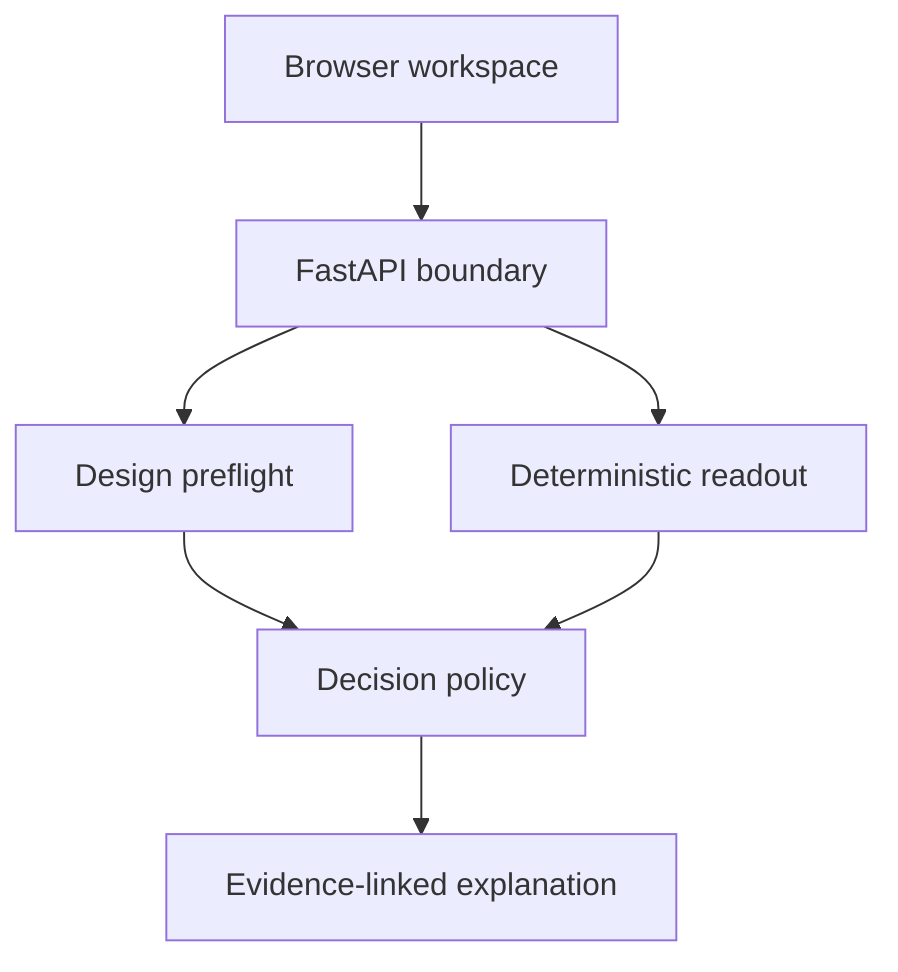

# Architecture

The MVP is deliberately small: a static browser UI calls a FastAPI boundary, which parses typed contracts and delegates every calculation to pure Python functions.

## Boundaries

- `frontend/`: dependency-free interface; contains no statistical implementation.
- `backend/app/parsing.py`: maps request dictionaries into frozen domain models.
- `statistics.py`: pure functions for power, two-proportion tests, SRM, and alpha adjustment.
- `design.py`: launch validation, sample size, duration, and bias checklist.
- `analysis.py`: validity checks and recommendation policy.
- `interpreter.py`: formats computed evidence; it cannot recompute or change results.
- `schema/`: versionable external contracts.
- `evaluation/`: product-policy acceptance cases, separate from unit tests.

## Trust model

Inputs are aggregated counts, not raw events. The service assumes randomization occurred upstream and therefore tests assignment balance rather than claiming to perform randomization. Set `API_TOKEN` in shared environments; when unset, the API is intentionally open for local development.
